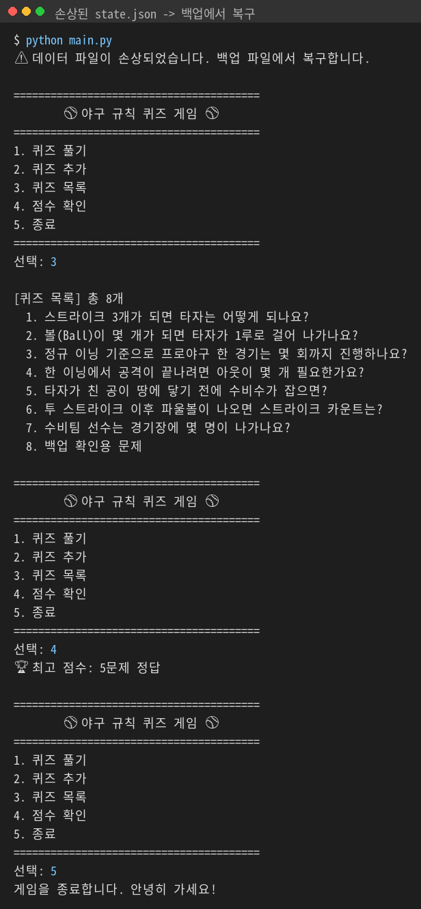

# ⚾ 야구 규칙 퀴즈 게임

## 1. 프로젝트 개요
터미널에서 실행하는 Python 퀴즈 게임입니다.
메뉴에서 번호를 골라 퀴즈를 풀고, 새 퀴즈를 추가하고, 목록과 최고 점수를 확인할 수 있습니다.
추가한 퀴즈와 최고 점수는 `state.json` 파일에 저장되어, 프로그램을 껐다 켜도 유지됩니다.

## 2. 퀴즈 주제와 선정 이유
- **주제:** 야구 규칙
- **선정 이유:** 야구는 국내에서 가장 인기 있는 스포츠지만, 스트라이크·볼·아웃 같은 기본 규칙을 정확히 모르는 사람이 많습니다. 문제-선택지-정답 구조로 명확하게 출제하기 좋아 퀴즈 주제로 선택했습니다.

## 3. 실행 방법
Python 3.8 이상이 필요합니다. 별도 설치 패키지는 없습니다.

```bash
git clone https://github.com/chaewon8227/codyssey_mission2.git
cd codyssey_mission2
python3 main.py      # Windows는 python main.py
```

## 4. 기능 목록
| 메뉴 | 기능 |
|---|---|
| 1. 퀴즈 풀기 | 저장된 퀴즈를 순서대로 출제, 정답/오답 표시, 마지막에 결과 출력, 최고 점수 갱신 |
| 2. 퀴즈 추가 | 문제·선택지 4개·정답 번호를 입력받아 등록 후 파일에 저장 |
| 3. 퀴즈 목록 | 등록된 퀴즈의 문제 목록 출력 |
| 4. 점수 확인 | 최고 점수 출력 (기록이 없으면 안내) |
| 5. 종료 | 저장 후 종료 |

**입력/예외 처리**
- 입력 앞뒤 공백 제거
- 빈 입력, 숫자가 아닌 입력, 범위 밖 숫자 → 안내 후 다시 입력
- Ctrl+C, 입력 종료(EOF) → 안내 후 저장하고 안전하게 종료
- `state.json`이 없으면 기본 퀴즈 사용, 손상되면 안내 후 **백업(`state.json.bak`)에서 복구**, 백업도 없거나 손상되면 기본 퀴즈로 초기화

## 5. 실행 화면

| 화면 | 이미지 |
|---|---|
| 잘못된 입력 처리 (문자, 빈 입력, 범위 밖 숫자, 앞뒤 공백) |  |
| 퀴즈 풀기 (정답/오답, 결과, 최고 점수 갱신) |  |
| 퀴즈 추가 (빈 입력, 범위 밖 정답 처리 포함) |  |
| 재실행 후 목록·최고 점수 유지 |  |
| 점수 확인 (아직 기록 없음) |  |
| Ctrl+C 입력 시 저장 후 안전 종료 |  |
| 손상된 state.json 복구 (백업 없음 → 기본 퀴즈) |  |
| 손상된 state.json 복구 (백업에서 복구, 추가 퀴즈·점수 유지) |  |
| 자동 테스트 23개 통과 |  |

## 6. 테스트

```bash
python test_quiz_game.py      # Mac은 python3
```

- Python 기본 라이브러리 `unittest`만 사용합니다. (설치 불필요)
- 실제 `state.json`을 건드리지 않도록 임시 폴더에서 실행합니다.
- 사용자 입력은 `unittest.mock`으로 미리 정한 값을 넣어 자동으로 검사합니다.

| 테스트 묶음 | 검사 내용 |
|---|---|
| TestQuiz | 정답 확인, dict 변환, 잘못된 퀴즈 데이터 거부 |
| TestInput | 공백 제거, 문자·빈 입력·범위 밖 숫자 재입력, 빈 문자열 거부 |
| TestGameFeatures | 기본 퀴즈 로드, 풀기·최고 점수 갱신, 추가, 목록, 점수, 퀴즈 없음 처리 |
| TestFileIO | 재실행 후 데이터 유지, UTF-8 JSON 저장, 손상 파일 복구 |
| TestBackup | 저장 전 백업 생성, 손상 시 백업에서 복구, 백업까지 손상 시 기본 퀴즈 |
| TestSafeExit | Ctrl+C·EOF 시 저장 후 안전 종료, 메뉴 종료 |

## 7. 파일 구조
```
codyssey_mission2/
├── main.py          # 실행 파일 (QuizGame 생성 후 실행)
├── quiz_game.py     # QuizGame 클래스: 메뉴, 게임 진행, 입력 처리, 저장/불러오기
├── quiz.py          # Quiz 클래스: 문제 1개 (출력, 정답 확인, dict 변환)
├── default_data.py  # 기본 퀴즈 7개
├── test_quiz_game.py # 자동 테스트 23개
├── docs/img/        # README 실행 화면 이미지
├── state.json       # 실행 시 자동 생성되는 데이터 파일 (Git 제외)
├── state.json.bak   # 저장 직전 상태의 백업 파일 (Git 제외)
├── .gitignore
└── README.md
```

## 8. 데이터 파일 설명 (state.json)
- **경로:** 프로젝트 루트 `state.json`
- **역할:** 퀴즈 목록과 최고 점수를 저장해, 다시 실행해도 데이터가 유지되게 함
- **인코딩:** UTF-8
- **생성 시점:** 퀴즈 추가, 최고 점수 갱신, 종료 시 저장

**스키마**
```json
{
  "quizzes": [
    {
      "question": "스트라이크 3개가 되면 타자는 어떻게 되나요?",
      "choices": ["볼넷 출루", "삼진 아웃", "자동 2루타", "다시 타석에 선다"],
      "answer": 2
    }
  ],
  "best_score": 6
}
```
| 키 | 타입 | 설명 |
|---|---|---|
| `quizzes` | list | 퀴즈 목록 |
| `question` | str | 문제 |
| `choices` | list[str] | 선택지 4개 |
| `answer` | int | 정답 번호 (1~4) |
| `best_score` | int 또는 null | 최고 정답 수 (아직 안 풀었으면 null) |

**백업과 복구 (state.json.bak)**

| 상황 | 동작 |
|---|---|
| 저장할 때 | 기존 `state.json`을 `state.json.bak`으로 복사한 뒤 새 내용을 씀 |
| 첫 실행 (파일 없음) | 기본 퀴즈 7개 사용 |
| `state.json` 손상, 백업 정상 | "백업 파일에서 복구합니다" 안내 후 백업 내용으로 복구 |
| 둘 다 손상 또는 백업 없음 | "기본 퀴즈 데이터로 복구합니다" 안내 후 기본 퀴즈로 초기화 |

복구한 뒤 다시 저장할 때는 백업을 만들지 않습니다. 손상된 파일이 정상 백업을 덮어쓰는 것을 막기 위해서입니다. 코드 위치: `quiz_game.py`의 `load()`, `read_state()`, `save()`

## 9. 개발 환경

| 항목 | 버전 |
|---|---|
| OS | Windows |
| Python | 3.11.6 |
| Git | 2.56.0 |

## 10. 설계 설명

### 클래스를 사용한 이유

함수만으로도 게임을 만들 수 있지만, 그러면 퀴즈 목록과 최고 점수를 함수마다 매개변수로 넘기거나 전역 변수로 둬야 합니다. 클래스는 **데이터와 그 데이터를 다루는 기능을 한 덩어리로 묶습니다.**

| 구분 | 함수만 사용 | 클래스 사용 (이 프로젝트) |
|---|---|---|
| 데이터 보관 | 전역 변수 또는 매번 매개변수로 전달 | `self.quizzes`, `self.best_score`에 보관 |
| 퀴즈 1개 표현 | dict (`q["answer"]`), 키 오타를 실행 전에 알기 어려움 | `Quiz` 객체 (`quiz.answer`), 정답 확인은 `quiz.is_correct()`로 통일 |
| 역할 분리 | 파일이 커지면 어느 함수가 무엇을 책임지는지 흐려짐 | `Quiz`는 문제 1개, `QuizGame`은 게임 전체로 책임이 나뉨 |
| 단점 | 구조가 단순해 작은 프로그램엔 충분 | 코드 양이 조금 늘고 `self` 개념을 알아야 함 |

### JSON 저장 방식의 한계

JSON은 사람이 읽을 수 있고 Python의 dict·list와 바로 바뀌어서 이 규모에 적합합니다. 다만 한계가 있습니다.

| 한계 | 이유 | 이 프로젝트에서 | 대안 |
|---|---|---|---|
| 속도 | 1개만 바꿔도 파일 전체를 다시 읽고 씀 | 퀴즈 수십 개라 문제 없음 | SQLite 같은 DB는 바뀐 부분만 씀 |
| 메모리 | 파일 전체를 한 번에 메모리에 올림 | 수 KB 수준이라 문제 없음 | 수만 건 이상이면 DB나 나눠 읽기 |
| 동시 사용 | 두 프로그램이 동시에 쓰면 한쪽 내용이 사라질 수 있음 | 혼자 쓰는 콘솔 게임이라 해당 없음 | DB는 잠금 기능을 제공 |
| 손상 | 쓰는 도중 꺼지면 파일이 깨질 수 있음 | **백업 파일로 대비** (8장) | DB의 트랜잭션 |

## 11. Git 작업 기록

### 커밋 기록 (10개 이상)

```
> git log --oneline --graph --all
* ad74caa (HEAD -> main, origin/main, origin/HEAD) docs: clone/pull 실습 기록
* f43e093 docs: README에 개발 환경 추가
* fd2d9ef chore: state.json을 Git 추적에서 제외
* 5c2d940 docs: 실행 화면 이미지와 테스트 설명 추가
* 32a954f test: 자동 테스트 20개 추가
* c538fbf docs: README 마지막 줄 인코딩 수정
* d7db25f docs: clone 실습 - README 한 줄 추가
* 8e242d5 docs: README 작성 (개요, 주제, 실행 방법, 기능, 파일 구조, 데이터 설명)
* f40e46d feat: state.json 저장/불러오기 및 예외 처리 (손상 복구, Ctrl+C·EOF 안전 종료)
* 97dabb2 refactor: QuizGame 클래스로 게임 구조 정리
* 8a4078b feat: 최고 점수 확인 및 갱신 기능 구현
* ca63947 feat: 퀴즈 목록 보기 기능 구현
* 263e18e feat: 퀴즈 추가 기능 구현 (입력 검증 포함)
*   faa2e6f merge: feature/play-quiz 브랜치를 main에 병합
|\
| * 2f2ec60 (origin/feature/play-quiz) feat: 퀴즈 풀기 기능 구현 (출제, 정답 판정, 결과 표시)
|/
* 5aecf2a feat: 기본 퀴즈 데이터 7개 작성 (야구 규칙)
* 4a1ce41 feat: Quiz 클래스 작성 (출력, 정답 확인, 변환 메서드)
* d81eb19 feat: 메뉴 출력 및 입력 검증 기능 추가
* c85074d chore: 초기 설정 (.gitignore, README 추가)
```

이 README 작성 시점 기준 커밋 19개입니다. 이후 커밋은 GitHub 저장소의 Commits 화면에서 확인할 수 있습니다.

### 커밋 규칙

**한 커밋 = 기능 하나**를 원칙으로 했습니다. 메뉴, Quiz 클래스, 기본 데이터, 퀴즈 풀기, 추가, 목록, 점수를 각각 따로 커밋해서 어느 커밋에서 무엇이 바뀌었는지 바로 알 수 있게 했습니다.

메시지는 `종류: 내용` 형식으로 썼습니다.

| 접두어 | 의미 | 예시 |
|---|---|---|
| `feat` | 새 기능 | `feat: 퀴즈 추가 기능 구현 (입력 검증 포함)` |
| `refactor` | 동작은 그대로 두고 구조만 정리 | `refactor: QuizGame 클래스로 게임 구조 정리` |
| `test` | 테스트 추가·수정 | `test: 자동 테스트 20개 추가` |
| `docs` | README 등 문서 | `docs: README 작성 (...)` |
| `chore` | 설정 등 기타 | `chore: state.json을 Git 추적에서 제외` |
| `merge` | 브랜치 병합 | `merge: feature/play-quiz 브랜치를 main에 병합` |

### 브랜치 생성과 병합

```
> git branch -a
* main
  remotes/origin/HEAD -> origin/main
  remotes/origin/feature/play-quiz
  remotes/origin/main
```

작업 순서는 이렇습니다.

```
git checkout -b feature/play-quiz      # 브랜치 만들고 이동
(퀴즈 풀기 기능 작성 후 커밋 → 2f2ec60)
git checkout main                      # main으로 돌아옴
git merge --no-ff feature/play-quiz    # 병합 커밋 faa2e6f 생성
```

위 커밋 그래프에서 `faa2e6f`의 `|\`, `|/` 모양이 브랜치가 갈라졌다가 합쳐진 기록입니다.

**브랜치를 나눈 이유:** 퀴즈 풀기는 게임의 핵심 기능이라 작업 중 오류가 생기기 쉽습니다. 별도 브랜치에서 작업하면 **완성 전까지 main은 항상 실행 가능한 상태**로 남습니다. 완성하고 확인한 뒤에 main에 합쳤습니다.

**병합의 의미:** 브랜치에서 한 작업을 main에 반영하는 것입니다. `--no-ff` 옵션으로 병합 커밋을 따로 남겨서, 나중에도 "이 기능은 브랜치에서 개발되어 합쳐졌다"는 기록이 그래프에 보이게 했습니다.

### clone과 pull 실습

원래 작업 폴더(`codyssey_mission2`) 외에 실습용 폴더(`m2_clone_test`)를 하나 더 clone했습니다.

```
> git clone https://github.com/chaewon8227/codyssey_mission2.git m2_clone_test
Cloning into 'm2_clone_test'...
remote: Enumerating objects: 64, done.
remote: Counting objects: 100% (64/64), done.
remote: Compressing objects: 100% (32/32), done.
remote: Total 64 (delta 34), reused 61 (delta 31), pack-reused 0 (from 0)
Receiving objects: 100% (64/64), 443.67 KiB | 15.84 MiB/s, done.
Resolving deltas: 100% (34/34), done.
```

실습용 폴더에서 README에 한 줄을 추가해 commit·push(`ad74caa`)한 뒤, 원래 폴더에서 `git pull`로 가져왔습니다. `git reflog`는 내 폴더에서 일어난 Git 작업을 순서대로 보여줍니다.

```
> git reflog          (원래 작업 폴더)
ad74caa (HEAD -> main, origin/main, origin/HEAD) HEAD@{0}: pull: Fast-forward
f43e093 HEAD@{1}: clone: from https://github.com/chaewon8227/codyssey_mission2.git
```

- `clone: from ...`: GitHub 저장소를 복제한 기록입니다.
- `pull: Fast-forward`: 다른 폴더에서 올린 `ad74caa`를 가져와 `f43e093`에서 `ad74caa`로 앞당긴 기록입니다.

같은 실습을 첫 작업 PC에서도 한 번 했습니다. 커밋 `d7db25f`(clone 실습 - README 한 줄 추가)가 그 기록입니다.
