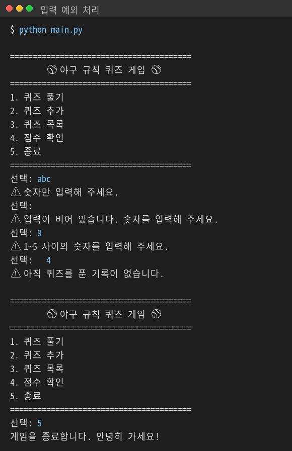
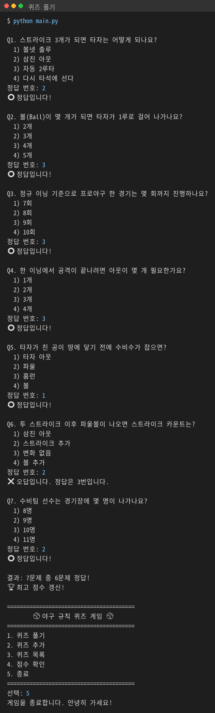
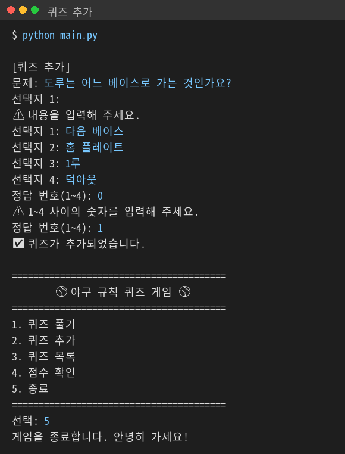
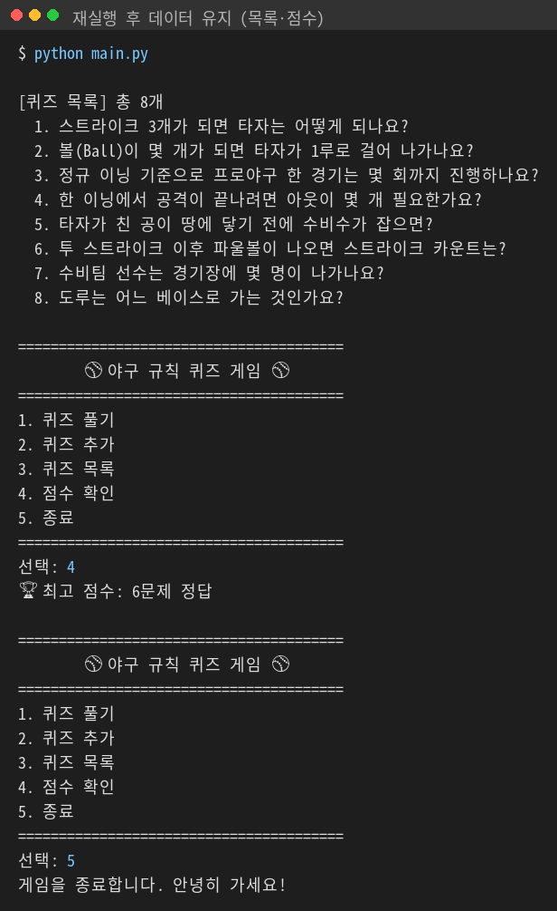
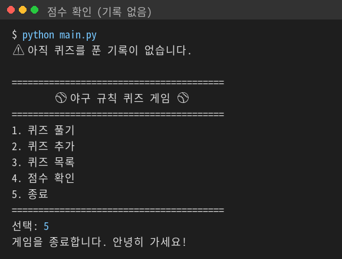
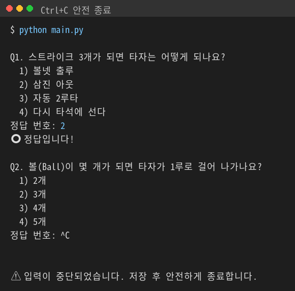
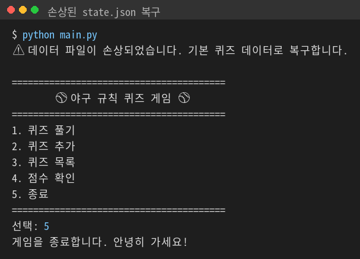
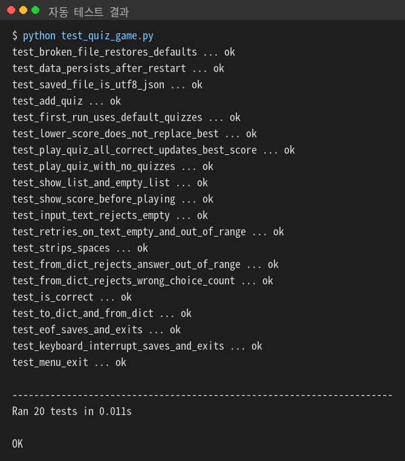

# ⚾ 야구 규칙 퀴즈 게임

## 1. 프로젝트 개요
터미널에서 실행하는 Python 퀴즈 게임입니다.
메뉴에서 번호를 골라 퀴즈를 풀고, 새 퀴즈를 추가하고, 목록과 최고 점수를 확인할 수 있습니다.
추가한 퀴즈와 최고 점수는 `state.json` 파일에 저장되어, 프로그램을 껐다 켜도 유지됩니다.

## 2. 퀴즈 주제와 선정 이유
- **주제:** 야구 규칙
- **선정 이유:** 야구는 국내에서 가장 인기 있는 스포츠지만, 스트라이크·볼·아웃 같은 기본 규칙을 정확히 모르는 사람이 많습니다. 문제-선택지-정답 구조로 명확하게 출제하기 좋아 퀴즈 주제로 선택했습니다.

## 3. 실행 방법
Python 3.8 이상이 필요합니다. 별도 설치 패키지는 없습니다.

```bash
git clone https://github.com/chaewon8227/codyssey_mission2.git
cd codyssey_mission2
python3 main.py      # Windows는 python main.py
```

## 4. 기능 목록
| 메뉴 | 기능 |
|---|---|
| 1. 퀴즈 풀기 | 저장된 퀴즈를 순서대로 출제, 정답/오답 표시, 마지막에 결과 출력, 최고 점수 갱신 |
| 2. 퀴즈 추가 | 문제·선택지 4개·정답 번호를 입력받아 등록 후 파일에 저장 |
| 3. 퀴즈 목록 | 등록된 퀴즈의 문제 목록 출력 |
| 4. 점수 확인 | 최고 점수 출력 (기록이 없으면 안내) |
| 5. 종료 | 저장 후 종료 |

**입력/예외 처리**
- 입력 앞뒤 공백 제거
- 빈 입력, 숫자가 아닌 입력, 범위 밖 숫자 → 안내 후 다시 입력
- Ctrl+C, 입력 종료(EOF) → 안내 후 저장하고 안전하게 종료
- `state.json`이 없으면 기본 퀴즈 사용, 손상되면 안내 후 기본 퀴즈로 복구

## 5. 실행 화면

| 화면 | 이미지 |
|---|---|
| 잘못된 입력 처리 (문자, 빈 입력, 범위 밖 숫자, 앞뒤 공백) |  |
| 퀴즈 풀기 (정답/오답, 결과, 최고 점수 갱신) |  |
| 퀴즈 추가 (빈 입력, 범위 밖 정답 처리 포함) |  |
| 재실행 후 목록·최고 점수 유지 |  |
| 점수 확인 (아직 기록 없음) |  |
| Ctrl+C 입력 시 저장 후 안전 종료 |  |
| 손상된 state.json 자동 복구 |  |
| 자동 테스트 20개 통과 |  |

## 6. 테스트

```bash
python test_quiz_game.py      # Mac은 python3
```

- Python 기본 라이브러리 `unittest`만 사용합니다. (설치 불필요)
- 실제 `state.json`을 건드리지 않도록 임시 폴더에서 실행합니다.
- 사용자 입력은 `unittest.mock`으로 미리 정한 값을 넣어 자동으로 검사합니다.

| 테스트 묶음 | 검사 내용 |
|---|---|
| TestQuiz | 정답 확인, dict 변환, 잘못된 퀴즈 데이터 거부 |
| TestInput | 공백 제거, 문자·빈 입력·범위 밖 숫자 재입력, 빈 문자열 거부 |
| TestGameFeatures | 기본 퀴즈 로드, 풀기·최고 점수 갱신, 추가, 목록, 점수, 퀴즈 없음 처리 |
| TestFileIO | 재실행 후 데이터 유지, UTF-8 JSON 저장, 손상 파일 복구 |
| TestSafeExit | Ctrl+C·EOF 시 저장 후 안전 종료, 메뉴 종료 |

## 7. 파일 구조
```
codyssey_mission2/
├── main.py          # 실행 파일 (QuizGame 생성 후 실행)
├── quiz_game.py     # QuizGame 클래스: 메뉴, 게임 진행, 입력 처리, 저장/불러오기
├── quiz.py          # Quiz 클래스: 문제 1개 (출력, 정답 확인, dict 변환)
├── default_data.py  # 기본 퀴즈 7개
├── test_quiz_game.py # 자동 테스트 20개
├── docs/img/        # README 실행 화면 이미지
├── state.json       # 실행 시 자동 생성되는 데이터 파일
├── .gitignore
└── README.md
```

## 8. 데이터 파일 설명 (state.json)
- **경로:** 프로젝트 루트 `state.json`
- **역할:** 퀴즈 목록과 최고 점수를 저장해, 다시 실행해도 데이터가 유지되게 함
- **인코딩:** UTF-8
- **생성 시점:** 퀴즈 추가, 최고 점수 갱신, 종료 시 저장

**스키마**
```json
{
  "quizzes": [
    {
      "question": "스트라이크 3개가 되면 타자는 어떻게 되나요?",
      "choices": ["볼넷 출루", "삼진 아웃", "자동 2루타", "다시 타석에 선다"],
      "answer": 2
    }
  ],
  "best_score": 6
}
```
| 키 | 타입 | 설명 |
|---|---|---|
| `quizzes` | list | 퀴즈 목록 |
| `question` | str | 문제 |
| `choices` | list[str] | 선택지 4개 |
| `answer` | int | 정답 번호 (1~4) |
| `best_score` | int 또는 null | 최고 정답 수 (아직 안 풀었으면 null) |
- clone 실습으로 추가한 줄


## 9. 개발 환경

| 항목 | 버전 |
|---|---|
| OS | Windows |
| Python | 3.11.6 |
| Git | 2.56.0 |- pull practice 2026-11-12
